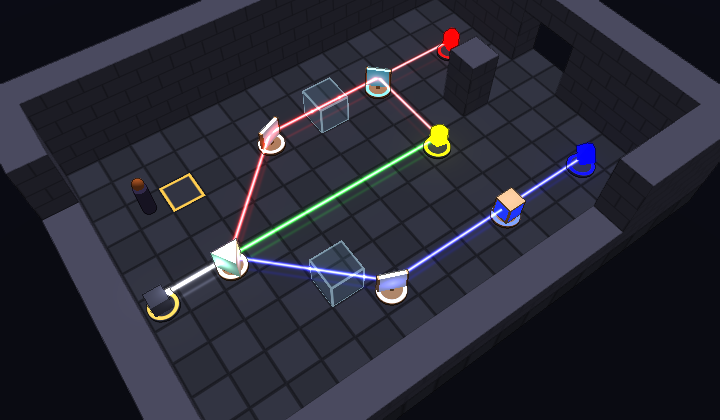
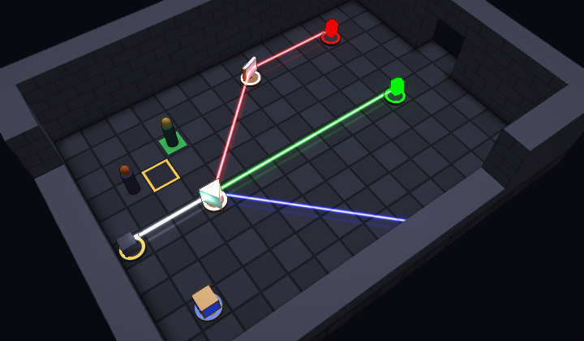
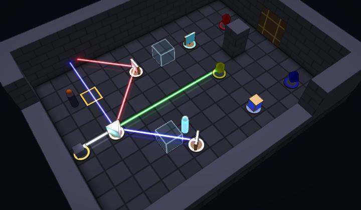
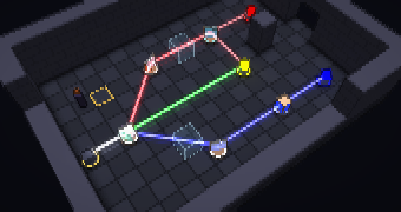

# 🔦 PRISM — 빛의 신전

> 2026년 2학기 ELEC462 시스템프로그래밍 팀 프로젝트 (Team 17)

**PRISM**은 그래픽 라이브러리 없이 **CPU 계산만으로 3D 장면을 그려 터미널에 출력하는 엔진**과, 그 위에서 돌아가는 **광학 퍼즐 게임**입니다.

어두운 신전의 방에서 거울, 반투명 거울, 프리즘, 필터, 유리 블록, 상자를 들고 옮기고 돌려서 레이저를 꺾고, 나누고, 섞고, 막습니다. 감지기로 창살을 열고, 순간이동 고리로 빛을 벽 너머로 보냅니다. 모든 수정에 알맞은 색의 빛이 닿으면 문이 열립니다.

- GPU, OpenGL, SDL, ncurses를 쓰지 않습니다. 복셀 레이캐스팅과 거리 함수(SDF)로 매 프레임을 CPU에서 직접 그립니다.
- 화면은 사분 블록 문자(`▘▝▖▌▞▛▀` 등)로 터미널 한 칸에 픽셀 네 개(2×2)를 24비트 ANSI 색으로 출력합니다.
- 렌더링은 POSIX 스레드 여러 개가 화면 줄을 나눠 맡습니다(`pthread_barrier`).
- 빛은 실제 광학 규칙을 따릅니다. 반사(`r = d − 2(d·n)n`), 스넬 법칙 굴절과 전반사, 프리즘 분광, 색 필터, 가산 혼색을 계산합니다.

> 혼자서는 방 9개를, 둘이서는(TCP 네트워크) 2인용 방까지 14개를 플레이합니다. 방 11~13은 벽으로 나뉜 **각자의 방**에서 서로의 방에 영향을 주며 푸는 2인 전용 방입니다. 방은 `levels/` 폴더의 텍스트 파일로 만들며, 파일을 추가하면 방이 늘어납니다.

| 내려다보기 (방 1, 풀린 상태) | 1인칭 |
|---|---|
|  |  |
| **발판과 창살 (방 4)** | **2인 협동 (방 6)** |
|  |  |
| **순간이동 고리 (방 8)** | **감지기·고리·상자 (방 10)** |
|  |  |
| **나뉜 2인용 방 (방 11)** | **힌트 안내자 (방 1)** |
|  |  |

> 위 스크린샷은 게임 렌더러가 720×420 픽셀로 직접 저장한 것입니다(`./prism --shot 파일.png`). 실제 터미널 화면의 해상도는 **창의 칸 수**로 정해집니다(한 칸에 2×2 픽셀). 아래는 170×45칸 터미널에서 보이는 모습을 그대로 재현한 것입니다(`./prism --term-shot 파일.png 170 45`).
>
> 
>
> **창을 최대화하고 글자 크기를 줄일수록(Windows Terminal: `Ctrl` + `-`) 선명해집니다.** 120칸 정도의 작은 창에서는 물체가 몇 픽셀로 작게 보입니다.

---

## 🔎 한눈에 보기: 시스템 프로그래밍 관점

| 부분 | 하는 일 | 시스템 프로그래밍 요소 | 코드 |
|---|---|---|---|
| 렌더러 | 픽셀마다 광선을 쏘아 복셀과 SDF 물체를 그림 | 작업 스레드(`pthread_create`), 바리어 3단계(`g_go` → `g_mid` → `g_done`)로 경계 픽셀 안티에일리어싱까지 동기화, 스레드 시작 관문(뮤텍스·조건 변수), `sysconf`로 코어 수 | `src/renderer/` |
| 터미널 출력 | 2×2 사분 블록, **바뀐 칸만** 출력 | `tcgetattr`/`tcsetattr` raw 모드, `ioctl(TIOCGWINSZ)`, 부분 쓰기와 `EINTR`를 처리하는 `write`, `SIGWINCH` | `src/platform/terminal.c` |
| 이벤트 루프 | 30fps로 입력·네트워크·파일 변화를 한곳에서 처리 | `timerfd`, `poll` 하나로 표준 입력·타이머·inotify·소켓을 함께 기다림 | `src/main.c` |
| 2인 협동 | 호스트가 진행, 참가자는 상태를 받아 그림 | 논블로킹 TCP, 5초 제한 `connect`와 `SO_ERROR`, 바이너리 프로토콜(버전 8), 받은 값의 범위·NaN 검사 | `src/net/` |
| 방 파일 | 텍스트 레벨, 게임 안 에디터 | `open`/`fstat`/`read`, 임시 파일 → `fsync` → `rename` 원자적 저장, **`inotify`로 실시간 다시 읽기** | `src/world/`, `src/main.c` |
| 진행 기록 | 푼 방과 최소 조작 수 | 같은 원자적 저장, `getenv` | `src/game/progress.c` |
| 시그널 | 어떻게 끝나도 터미널 복구 | `sigaction`(`SIGINT`, `SIGTERM`, `SIGHUP`) | `src/platform/terminal.c` |
| 시험 | 기준 커밋과 결과를 바이트 단위로 비교 | `fork`, `dup2`, `chdir`, `execv`, `waitpid`, AddressSanitizer·UBSan 빌드 | `tests/baseline.c` |
| 성능 표시 (`P`) | 스레드별 작업·대기 시간, 터미널 출력 바이트 | `clock_gettime(CLOCK_MONOTONIC)`, 해상도 자동 조절 | `src/game/hud.c` |

**비슷해 보일 수 있는 프로젝트와 다른 점**
- **터미널 그래픽**: 한 칸을 점자 문자(2×4 점, 한 색)로 쪼개는 방식과 달리, 2×2 사분 블록에 **칸마다 두 색을 밝기 가중 오차가 가장 작게 고르는** 방식입니다. 그리고 그 위에서 3D 레이캐스팅과 광학 시뮬레이션을 직접 계산하는 것이 핵심입니다.
- **2인 협동**: 네트워크 협동은 덧붙인 기능입니다. 중심은 CPU 3D 렌더러와 광학 엔진이고, 혼자 하기만으로도 모든 기능을 씁니다. 협동 방도 "서로의 빛과 발판이 상대 방을 연다"는 광학 퍼즐 규칙 위에 있습니다.

---

## 👥 팀원

| 이름 | GitHub | 역할 |
|---|---|---|
| 김동익 | [@bbabang7709](https://github.com/bbabang7709) | <!-- TODO: 역할 --> |
| 이준우 | [@junu0305](https://github.com/junu0305) | <!-- TODO: 역할 --> |

## 📅 개발 기간

2026.11 ~ 2026.12 (제안 발표 2026.11.10, 코드 제출 2026.12.20)

---

## 🛠 개발 환경

| 항목 | 내용 |
|---|---|
| 운영체제 | Ubuntu 24.04 (WSL2 포함) |
| 언어 | C (GNU C17) |
| 컴파일러 | GCC 13 |
| 빌드 | GNU Make |
| 라이브러리 | libc, libm, POSIX threads, BSD 소켓 (외부 라이브러리 없음) |
| 권장 터미널 | Windows Terminal (24비트 색, UTF-8, win32 입력 모드 지원) |

## 📦 필요 패키지 설치

```bash
sudo apt update
sudo apt install build-essential
```

---

## 🔨 빌드

프로젝트 루트에서 실행합니다.

```bash
make
```

`src/` 아래 모듈을 `build/`에 따로 컴파일한 뒤, 루트에 실행 파일 `prism`을 만듭니다. `-march=native`로 빌드하므로, 실행할 컴퓨터에서 소스로 빌드하세요(다른 CPU에서 만든 실행 파일은 돌지 않을 수 있습니다).

## ▶️ 실행

```bash
./prism
```

옵션 없이 실행하면 **시작 메뉴**가 열립니다. 풀린 방이 천천히 도는 화면 위에서 고릅니다.

| 메뉴 | 내용 |
|---|---|
| 혼자 하기 | `←` `→`로 시작 방을 고르고 Enter (2인용 방은 빠집니다). 처음에는 아직 못 푼 첫 방이 골라져 있고, 푼 방에는 `✓ 7번`처럼 가장 적은 조작 횟수가 붙습니다 |
| 호스트로 시작 | `←` `→`로 시작 방을 고르고 Enter. 다른 사람이 참가할 때까지 혼자 움직일 수 있습니다 |
| 참가하기 | Enter를 누르고 호스트 주소(예: `192.168.0.10`, `127.0.0.1:5462`)를 입력한 뒤 Enter |
| 방 만들기 | `←` `→`로 고칠 방이나 "새 방"을 고르고 Enter (레벨 에디터) |
| 조작법 | 키 설명 |
| 끝내기 | 종료 (ESC도 같음) |

- 게임 중에 ESC를 누르면 메뉴로 돌아갑니다. 호스트나 참가자였다면 연결을 끊습니다.
- 마지막 방의 문을 지나면 걸린 시간과 조작 횟수를 보여 주는 끝 화면이 나오고, Enter로 메뉴에 돌아갑니다.
- 참가 중 호스트와 연결이 끊어지면 이유를 보여 주며 메뉴로 돌아갑니다.
- **진행 기록**: 혼자 하기와 호스트에서 방을 풀고 문을 지나면, 그 방과 조작 횟수를 홈 폴더의 `~/.prism_progress`에 남깁니다(더 적은 횟수로 풀면 새 기록). 다른 파일을 쓰려면 `PRISM_PROGRESS=경로 ./prism`, 기록을 지우려면 그 파일을 지우면 됩니다.

- 터미널 창은 **80×24칸 이상**이어야 하며, 클수록 선명합니다. Windows Terminal에서는 창을 최대화하는 것을 권장합니다.
- Windows Terminal에서는 키를 누르고 있는 동안 계속 걷습니다. 화면 위쪽에 `키 누름/뗌`이 표시됩니다.
- 다른 터미널에서는 키 반복으로 누르고 있음을 흉내 내며, 화면 위쪽에 `키 탭`이 표시됩니다.
- 일반 터미널은 `Shift`만 눌렀다는 것을 알려 주지 않습니다. 그래서 `Shift`+`W`처럼 대문자 `W` `A` `S` `D`가 들어오면 달리기로 봅니다(Caps Lock이 켜져 있으면 늘 달립니다). Windows Terminal과 마우스 도우미에서는 `Shift` 키를 그대로 읽습니다.
- 방 파일은 `./levels`에서 먼저 찾고, 없으면 실행 파일 옆의 `levels` 폴더에서 찾습니다. 둘 다 없으면 기본 방 하나로 시작합니다.

### 둘이서 하기 (2인 협동)

한 사람이 호스트로 시작하고, 다른 사람이 그 주소로 참가합니다. 같은 컴퓨터의 터미널 두 개로도 할 수 있습니다. 시작 메뉴에서 해도 되고, 아래처럼 명령행으로 바로 시작해도 됩니다.

```bash
./prism --host
```

```bash
./prism --join 192.168.0.10
```

- 호스트 화면 둘째 줄에 참가할 주소와 포트가 표시됩니다(기본 포트 5462). 포트를 바꾸려면 `./prism --host 6000`, `./prism --join 192.168.0.10:6000`처럼 씁니다.
- 같은 컴퓨터에서는 `./prism --join 127.0.0.1`로 참가합니다.
- 각자 자기 터미널에서 자기 시점으로 봅니다. 상대는 다른 색 몸으로 보이고, 두 사람의 몸이 모두 빛을 가립니다.
- 방 파일은 호스트 것만 있으면 됩니다. 참가자는 방을 네트워크로 받습니다.
- 참가자가 나가면 호스트는 혼자 계속할 수 있고, 다시 참가할 수 있습니다. 호스트가 끝내면 참가자는 메뉴로 돌아갑니다.

## 🧹 정리

```bash
make clean
```

## 🧪 시험

```bash
make test     # 기준 커밋(기본: 마지막 커밋)과 결과 비교 + 모든 방 풀이 확인
make check    # 모든 방 풀이 확인만
make sanitize # AddressSanitizer·UBSan 빌드 (prism-san)
```

- `make test`는 기준 커밋의 소스를 `git archive`로 꺼내 같은 플래그로 빌드하고, C로 작성한 비교 프로그램(`tests/baseline.c`)이 두 실행 파일을 같은 인자로 실행(`fork`, `execv`, `dup2`, `waitpid`)해 `--check` 출력과 스크린샷 8장이 **바이트 단위로 같은지** 비교합니다. 이어서 모든 방이 닫힌 문으로 시작하고 풀 수 있는지 확인합니다.
- git 기록이 없는 사본(zip 등)에서는 기준 비교를 건너뛰고 방 풀이 확인만 합니다.
- 자세한 내용, 메모리 검사 결과, 모든 명령행 옵션은 [docs/TESTING.md](docs/TESTING.md)에 있습니다.

---

## 🎮 조작법

플레이어는 방 안을 걸어 다니며 물체를 들고, 내려놓고, 돌립니다. 움직일 수 있는 물체는 **구리색 받침** 위에 있습니다.

| 키 | 1인칭 (처음 시점) | 내려다보기 |
|---|---|---|
| `W` `A` `S` `D` | 걷기 | 카메라 기준으로 걷기 |
| `Shift` + 걷기 | 달리기 (걷기 3칸/초 → 5칸/초) | 같음 |
| `Space` | 점프 (약 0.6칸 높이, 바닥에 있을 때만) | 같음 |
| 방향키 | 시선 돌리기 | `←` `→` 카메라 45도 회전, `↑` `↓` 기울기 |
| `F` / 마우스 왼쪽 클릭 | 조준점의 물체 들기, 빈 바닥에 내려놓기 | 내 앞 칸의 물체 들기·내려놓기 |
| `Q` `E` / 마우스 휠 | 겨눈(또는 든) 거울을 22.5도씩 돌리기 | 같음 |
| `Tab` | 내려다보기로 전환 | 1인칭으로 전환 |
| 마우스 이동 / `V` | Windows 마우스 도우미를 쓸 때 시선 돌리기, `V`로 켜고 끄기 ([docs/WINDOWS.md](docs/WINDOWS.md)) | 쓰지 않음 (포인터는 풀려 있음) |
| `+` `-` | | 확대, 축소 |
| `Z` | 마지막 조작(들기·놓기·돌리기) 되돌리기. 방마다 64번까지 | 같음 |
| `I` | 힌트: 다음에 할 일 하나를 알려 주고, 빛나는 **안내자**가 그 물체(또는 놓을 칸) 옆으로 걸어가 떠 있음. 물체에 테두리를, 놓을 칸에 노란 사각형을 깜빡여 보여 줌 (8초) | 같음 |
| `P` | 성능 표시: 렌더 스레드별 작업·대기 시간, 해상도, 빛 계산 시간, 터미널 출력 바이트 | 같음 |
| `R` | 처음 상태로 | 같음 |
| `H` | 도움말 줄 숨기기/보이기 (화면 아래 도움말 줄에는 조작 키만 보이고, 이동 키는 메뉴의 "조작법"에 있음) | 같음 |
| `G` | 화면 방식 바꾸기: 2×2 선명 ↔ 반블록 | 같음 |
| `ESC` | 메뉴로 (메뉴에서는 끝내기) | 같음 |
| `Ctrl+C` | 바로 종료 | 같음 |

- **겨누기**: 1인칭에서는 조준점에서 4.5칸 안의 물체나 바닥을 겨눕니다. 겨눈 물체에는 노란 테두리가, 물체를 놓을 수 있는 바닥 칸에는 노란 사각형이 표시됩니다.
- **들고 있는 동안**: 그 물체는 방에서 빠지므로 빛이 그대로 지나갑니다.
- **몸이 빛을 가립니다**: 빛줄기 앞에 서면 그 뒤로 빛이 가지 않습니다.
- **마우스 시선 (Windows, 선택)**: 터미널은 마우스 포인터를 숨기거나 붙잡아 둘 수 없어서, Windows 쪽 도우미(`tools/mouselock.c`)가 포인터를 잡고 이동량을 TCP(127.0.0.1)로 보내 줍니다. 도우미 없이도 모든 기능을 키보드로 씁니다. 사용법은 [docs/WINDOWS.md](docs/WINDOWS.md)를 보세요.

## 🧩 게임 규칙 요약

- **방의 수정이 모두 알맞은 색의 빛을 받으면 문이 열립니다.** 열린 문으로 걸어 들어가면 다음 방으로 넘어갑니다.
- 거울은 22.5도씩 돌아가고, 반투명 거울은 빛을 반반 나누고, 프리즘은 흰빛을 빨강·초록·파랑으로 나눕니다. 필터는 한 색만 통과시키고, 유리 블록은 빛을 굴절시킵니다.
- 수정은 6가지입니다. 노랑 = 빨강 + 초록, 청록 = 초록 + 파랑, 자홍 = 빨강 + 파랑처럼 섞인 색은 두 빛이 함께 닿아야 켜지고, 원하지 않는 색이 섞이면 켜지지 않습니다.
- 발판(사람이나 물체가 누름)과 감지기(빛을 받으면 켜짐)가 창살을 엽니다. 순간이동 고리는 빛을 벽 너머로 보내고, 상자는 빛을 막습니다.
- 물체별 동작, 물체 구분법, 방 14개의 내용은 [docs/GAME.md](docs/GAME.md), 방을 만드는 방법은 [docs/LEVELS.md](docs/LEVELS.md)에 있습니다.

---

## ✨ 주요 기능

자세한 설명은 [docs/DESIGN.md](docs/DESIGN.md)에 있습니다.

1. **CPU 3D 렌더러**: 3D DDA 복셀 레이캐스팅, SDF 물체와 구 추적, 빛줄기 발광, 앰비언트 오클루전과 접지 그림자, 경계 픽셀만 다시 쏘는 안티에일리어싱
2. **멀티스레드 렌더링**: 코어 수만큼(최대 8개) 작업 스레드, 바리어 3단계로 프레임 동기화
3. **광학 시뮬레이션**: 반사, 반투명 분할, 프리즘 분광, 필터, 스넬 굴절과 전반사, 순간이동 고리, 몸에 가려짐
4. **두 가지 시점**: 1인칭(가로 90도)과 내려다보기(카메라 쪽 벽 잘라내기)
5. **물체 조작과 퍼즐 판정**: 들기·놓기·돌리기, 발판·감지기·창살, 되돌리기 64번, 달리기·점프, 힌트와 BFS 힌트 안내자
6. **터미널 출력 엔진**: 칸마다 두 색을 고르는 2×2 사분 블록, 앞·뒤 칸 버퍼로 바뀐 칸만 출력, 한글 두 칸 처리, `SIGWINCH`
7. **입력 처리**: 이스케이프 시퀀스, SGR 마우스, win32 입력 모드(누름/뗌)를 직접 해석
8. **방 파일**: 이름 순서로 읽기, 파일과 줄 번호로 오류 보고, inotify와 수정 시각 지문으로 실시간 다시 읽기
9. **2인 협동 네트워크**: 논블로킹 TCP와 단일 `poll` 루프, 바이너리 메시지, 입력 검증, 나뉜 2인 방
10. **시작 메뉴와 끝 화면**: 도는 3D 배경, 시작 방 고르기, 주소 입력, 진행 기록 표시
11. **레벨 에디터**: 놓기·지우기·돌리기, 자동 풀이로 풀이 확인, 시험 플레이, 원자적 저장
12. **성능 표시와 해상도 자동 조절**: 스레드별 시간과 출력 바이트를 보여 주고, 느리면 해상도를 낮춰 30fps 유지
13. **시험·스크린샷 모드**: 화면 없이 상태 출력, 자동 풀이, 외부 라이브러리 없이 PNG 저장

---

## ⚙️ 사용한 시스템 프로그래밍 요소

| 분류 | 시스템 콜 / 라이브러리 | 사용 위치와 목적 |
|---|---|---|
| 터미널 제어 | `tcgetattr`, `tcsetattr` | raw 모드 전환과 복구 (`platform/terminal.c`) |
| | `ioctl(TIOCGWINSZ)` | 터미널 창 크기 읽기 |
| | `isatty` | 터미널에서 실행했는지 확인 (`main.c`) |
| 입출력 | `read` | 표준 입력 바이트 읽기 (`platform/input.c`), timerfd 만료 횟수 읽기 |
| | `write` | 프레임 출력, 부분 쓰기와 `EINTR` 처리 (`platform/terminal.c`) |
| | `poll` | 표준 입력, 타이머, inotify, 소켓을 한 번에 기다리는 이벤트 루프 (`main.c`) |
| 시간 | `timerfd_create`, `timerfd_settime` | 30fps 게임 틱 (실패하면 바로 알리고 끝냄) |
| | `clock_gettime(CLOCK_MONOTONIC)` | 키 누름 유지 시간, ESC 판별, fps, 렌더·빛 계산 시간 측정 |
| 시그널 | `sigaction` | `SIGINT`, `SIGTERM`, `SIGHUP`은 정상 종료, `SIGWINCH`는 창 크기 변경 |
| 스레드 | `pthread_create`, `pthread_join` | 렌더링 작업 스레드, 마우스 도우미 연결 스레드 생성과 종료 |
| | `pthread_mutex_lock`, `pthread_cond_wait`, `pthread_cond_broadcast` | 렌더 스레드 시작 관문(실제로 만든 스레드 수로 바리어를 만든 뒤 출발), 도우미 스레드와 데이터 나눠 쓰기 (`renderer/renderer.c`, `platform/bridge.c`) |
| | `pthread_barrier_init`, `pthread_barrier_wait` | 프레임마다 스레드 동기화 |
| | `sysconf(_SC_NPROCESSORS_ONLN)` | CPU 코어 수만큼 스레드 수 결정 |
| 파일 | `opendir`, `readdir`, `closedir` | `levels/` 폴더에서 방 파일 목록 읽기 (`world/world.c`) |
| | `inotify_init1`, `inotify_add_watch`, `read` | 방 폴더를 지켜보다가 파일이 바뀌면 방을 다시 읽기. inotify 디스크립터도 `poll`로 기다림 (`main.c`) |
| | `fstatat`, `dirfd` | 방 파일의 크기·수정 시각 지문 (Windows에서 고친 파일을 알아채는 대비책) |
| | `open`, `fstat`, `read`, `close` | 방 파일 읽기 (크기 확인 후 한 번에 읽기), timerfd 닫기 |
| | `readlink("/proc/self/exe")` | 다른 폴더에서 실행했을 때 실행 파일 옆의 `levels` 찾기 |
| | `open(O_CREAT\|O_TRUNC)`, `write`, `fsync`, `rename`, `unlink`, `mkdir` | 에디터의 방 저장: 임시 파일에 쓰고 디스크에 확정한 뒤 한 번에 바꿔 넣기 (`world/world.c`) |
| | `getenv`, `open`, `read`, `write`, `fsync`, `rename` | 진행 기록 읽기·저장 (`~/.prism_progress`, 같은 방식으로 한 번에 바꿔 넣기) (`game/progress.c`) |
| | `fopen`, `fwrite`, `fclose` | 스크린샷 PPM·PNG 저장 |
| 네트워크 | `socket`, `bind`, `listen`, `accept4` | 호스트가 참가자 접속 받기 (`net/net.c`) |
| | `getaddrinfo`, `connect`, `getsockopt(SO_ERROR)` | 참가자가 논블로킹으로 접속하고 결과 확인 (5초 제한) |
| | `send`, `recv`, `poll` | 메시지 주고받기. 보내기 버퍼가 차면 `POLLOUT`을 기다림 |
| | `fcntl(O_NONBLOCK)`, `setsockopt(TCP_NODELAY, SO_REUSEADDR)` | 논블로킹 소켓(실패하면 그 연결을 닫음), 작은 메시지 바로 보내기 |
| | `getifaddrs` | 호스트 화면에 참가할 주소 표시 |
| | `socket`, `bind(127.0.0.1)`, `listen`, `accept`, `recv`, `send(MSG_NOSIGNAL)`, `poll` | 마우스 잠금 도우미 연결: 이 컴퓨터 안에서만 받는 포트 47017 (`platform/bridge.c`) |
| 프로세스 (시험) | `fork`, `execv`, `dup2`, `chdir`, `waitpid` | `make test`에서 기준 커밋 빌드와 새 빌드를 실행해 출력 비교 (`tests/baseline.c`) |

---

## 📁 프로젝트 구조

```
Project-Prism/
├── Makefile
├── README.md
├── docs/
│   ├── DESIGN.md              # 엔진 설계와 구현 (주요 기능 13가지, 모듈 의존 관계)
│   ├── GAME.md                # 게임 규칙, 물체 구분법, 방 14개
│   ├── LEVELS.md              # 레벨 에디터, 방 파일 형식
│   ├── TESTING.md             # make test·check·sanitize, 메모리 검사 결과, 명령행 옵션
│   ├── WINDOWS.md             # (선택) Windows 마우스 시선 도우미
│   └── images/                # README 스크린샷 (./prism --shot 으로 저장)
├── levels/                    # 방 파일 (이름 순서대로 방 1, 2, ...)
│   ├── 01-temple.lvl
│   ├── 02-crossroads.lvl
│   ├── 03-meeting.lvl
│   ├── 04-pressure-plate.lvl  # 발판과 창살
│   ├── 05-two-keepers.lvl     # 2인용 방
│   ├── 06-gatekeeper.lvl      # 2인용 방
│   ├── 07-light-key.lvl       # 감지기
│   ├── 08-portal.lvl          # 순간이동 고리
│   ├── 09-boxes.lvl           # 상자
│   ├── 10-all-devices.lvl     # 모든 장치
│   ├── 11-handover.lvl        # 나뉜 2인용 방: 전달 창구로 상자 건네기
│   ├── 12-pass-the-light.lvl  # 나뉜 2인용 방: 고리로 빛 넘기기, 감지기로 상대 창살 열기
│   ├── 13-trade.lvl           # 나뉜 2인용 방: 거울과 프리즘 바꿔 쓰기
│   └── 14-color-mix.lvl       # 색 섞기: 청록·자홍 수정
├── src/
│   ├── main.c                 # 명령행 옵션, 시험·스크린샷 모드, 30fps 이벤트 루프, 방 파일 실시간 다시 읽기
│   ├── common/
│   │   ├── config.h           # 방·버퍼 크기, 스레드 수, 플레이어 크기 상수
│   │   ├── mathutil.h         # clampf
│   │   └── types.h            # Seg: 광학이 만들고 렌더러가 그리는 빛줄기 선분, Body: 플레이어 몸
│   ├── world/
│   │   └── world.c/.h         # 방 파일 읽기·검사·저장, 복셀 블록, 물체 목록, 문 열고 닫기
│   ├── optics/
│   │   └── optics.c/.h        # 빛 시뮬레이션 (반사, 분할, 분광, 굴절, 필터, 수정, 감지기, 순간이동 고리, 상자)
│   ├── renderer/
│   │   ├── renderer.c/.h      # View로 한 프레임 그리기, 작업 스레드와 시간 측정, 윤곽선, 비네트, PPM·PNG 저장
│   │   └── raycast.c/.h       # 화면 광선 추적, 물체 SDF, 표면 조명 (렌더러 내부)
│   ├── game/
│   │   ├── game.c/.h          # 플레이어·카메라, 달리기·점프, 겨누기, 들기·놓기·돌리기, 퍼즐 판정, 방 이동, 자동 풀이, 힌트 안내자
│   │   ├── hud.c/.h           # 픽셀 → 블록 문자 칸(2×2 사분 블록, 반블록), 상태 줄, 안내, 도움말, 알림, 끝 화면, 성능 표시, 해상도 자동 조절
│   │   ├── menu.c/.h          # 시작 메뉴 (도는 3D 배경, 시작 방 고르기, 주소 입력, 조작법)
│   │   ├── progress.c/.h      # 진행 기록 (푼 방과 가장 적은 조작 횟수, ~/.prism_progress)
│   │   └── editor.c/.h        # 레벨 에디터 (놓기·지우기·돌리기, 풀이 확인, 시험 플레이, 저장)
│   ├── net/
│   │   └── net.c/.h           # 2인 협동: TCP 호스트·참가, 메시지 형식, 상태 동기화
│   └── platform/
│       ├── terminal.c/.h      # raw 모드, 칸 버퍼, 바뀐 칸만 출력(쓴 바이트 집계), 시그널
│       ├── input.c/.h         # 키·마우스·win32 입력 해석 (콜백으로 알림)
│       ├── bridge.c/.h        # Windows 마우스 잠금 도우미와의 TCP 연결 (127.0.0.1:47017)
│       └── clock.h            # 단조 시계
├── tools/
│   └── mouselock.c            # (선택) Windows 도우미: 게임 실행, 포인터 숨김·고정, 마우스 이동량, 실제 키 상태
└── tests/
    └── baseline.c             # 기준 커밋과 결과 비교, 방 풀이 확인 (make test, make check)
```

모듈 사이의 의존 관계와 설계 원칙은 [docs/DESIGN.md](docs/DESIGN.md#모듈-의존-관계)에 있습니다.

---

## 📏 코드 규모

| 모듈 | 코드 줄 수 |
|---|---:|
| `game` (게임, HUD, 메뉴, 에디터, 진행 기록, 힌트 안내자) | 1,641 |
| `renderer` | 886 |
| `platform` (터미널, 입력, 도우미 연결) | 521 |
| `net` | 510 |
| `main.c` | 498 |
| `world` | 478 |
| `optics` | 237 |
| `common` | 27 |
| **합계** | **4,798** |

주석과 빈 줄을 뺀 C 코드 줄 수이며, `tests/`(211줄)와 Windows 도우미 `tools/mouselock.c`(432줄)는 포함하지 않았습니다.

---

## 🚀 앞으로의 계획

- [ ] **UI 개편**: 메뉴, 상태 줄, 알림, 끝 화면을 보기 좋게 다시 꾸미기
- [ ] **레벨 재배치 (혼자 + 2인)**: 지금 있는 방들을 장치가 하나씩 늘어나는 순서로 다시 배치하기. 새 장치가 처음 나오는 방에 들어갈 때 그 장치를 짧게 설명하기
- [ ] **튜토리얼**: 걷기, 들기·놓기, 거울 돌리기, 시점 바꾸기를 차례로 익히는 첫 방
- [ ] (선택) **든 물체 창**: 손에 든 물체가 무엇인지 화면 오른쪽 아래의 사각형 창에 보여 주기
- [ ] **최적화와 코드 정리**: 그래픽 개선 포함, 코드 리팩토링
- [ ] 빛줄기의 위아래 방향 (높이가 다른 층)
