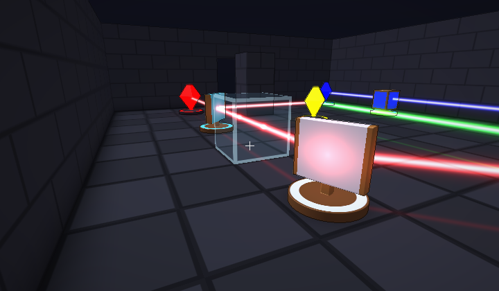
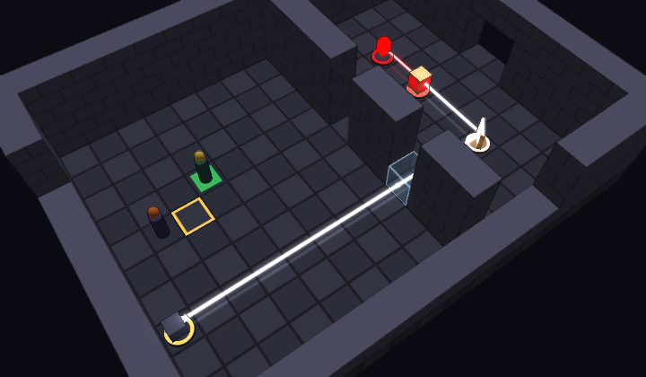
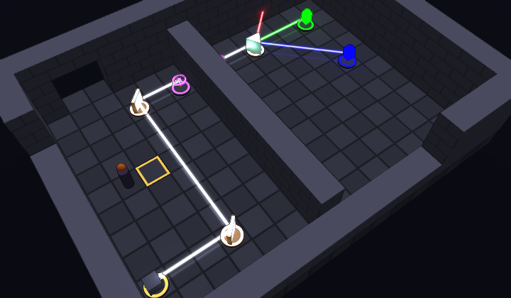
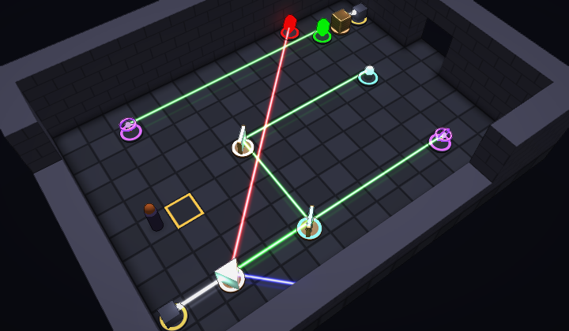
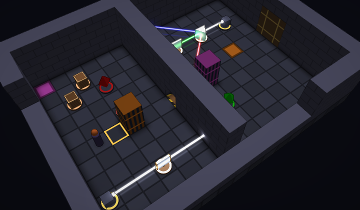

# 🔦 PRISM — 빛의 신전

> 2026년 2학기 ELEC462 시스템프로그래밍 팀 프로젝트 (Team <!-- TODO: 팀 번호 -->)

**PRISM**은 그래픽 라이브러리 없이 **CPU 계산만으로 3D 장면을 그려 터미널에 출력하는 광학 퍼즐 게임**입니다.

어두운 신전의 방에서 거울, 반투명 거울, 프리즘, 필터, 유리 블록, 상자를 들고 옮기고 돌려서 레이저를 꺾고, 나누고, 섞고, 막습니다. 감지기로 창살을 열고, 순간이동 고리로 빛을 벽 너머로 보냅니다. 모든 수정에 알맞은 색의 빛이 닿으면 문이 열립니다.

- GPU, OpenGL, SDL, ncurses를 쓰지 않습니다. 복셀 레이캐스팅과 거리 함수(SDF)로 매 프레임을 CPU에서 직접 그립니다.
- 화면은 사분 블록 문자(`▘▝▖▌▞▛▀` 등)로 터미널 한 칸에 픽셀 네 개(2×2)를 24비트 ANSI 색으로 출력합니다.
- 렌더링은 POSIX 스레드 여러 개가 화면 줄을 나눠 맡습니다(`pthread_barrier`).
- 빛은 실제 광학 규칙을 따릅니다. 반사(`r = d − 2(d·n)n`), 스넬 법칙 굴절과 전반사, 프리즘 분광, 색 필터를 계산합니다.

> 혼자서는 방 8개를, 둘이서는(TCP 네트워크) 2인용 방까지 13개를 플레이합니다. 방 11~13은 벽으로 나뉜 **각자의 방**에서 서로의 방에 영향을 주며 푸는 2인 전용 방입니다. 방은 `levels/` 폴더의 텍스트 파일로 만들며, 파일을 추가하면 방이 늘어납니다.

| 내려다보기 (방 1, 풀린 상태) | 1인칭 |
|---|---|
|  |  |
| **발판과 창살 (방 4)** | **2인 협동 (방 6)** |
|  |  |
| **순간이동 고리 (방 8)** | **감지기·고리·상자 (방 10)** |
|  |  |
| **나뉜 2인용 방 (방 11)** | |
|  | |

> 위 스크린샷은 게임 렌더러가 720×420 픽셀로 직접 저장한 것입니다(`./prism --shot 파일.png`). 실제 터미널 화면의 해상도는 **창의 칸 수**로 정해집니다(한 칸에 2×2 픽셀). 아래는 170×45칸 터미널에서 보이는 모습을 그대로 재현한 것입니다(`./prism --term-shot 파일.png 170 45`).
>
> 
>
> **창을 최대화하고 글자 크기를 줄일수록(Windows Terminal: `Ctrl` + `-`) 선명해집니다.** 120칸 정도의 작은 창에서는 물체가 몇 픽셀로 작게 보입니다.

---

## 👥 팀원

| 이름 | GitHub | 역할 |
|---|---|---|
| <!-- TODO --> | [@bbabang7709](https://github.com/bbabang7709) | <!-- TODO --> |
| <!-- TODO --> | <!-- TODO --> | <!-- TODO --> |

## 📅 개발 기간

2026.11 ~ 2026.12 (제안 발표 2026.11.10, 코드 제출 2026.12.20)

---

## 🛠 개발 환경

| 항목 | 내용 |
|---|---|
| 운영체제 | Ubuntu 24.04 (WSL2 포함) |
| 언어 | C (GNU C17) |
| 컴파일러 | GCC 13 |
| 빌드 | GNU Make |
| 라이브러리 | libc, libm, POSIX threads, BSD 소켓 (외부 라이브러리 없음) |
| 권장 터미널 | Windows Terminal (24비트 색, UTF-8, win32 입력 모드 지원) |

## 📦 필요 패키지 설치

```bash
sudo apt update
sudo apt install build-essential
```

---

## 🔨 빌드

프로젝트 루트에서 실행합니다.

```bash
make
```

`src/` 아래 모듈을 `build/`에 따로 컴파일한 뒤, 루트에 실행 파일 `prism`을 만듭니다.

## ▶️ 실행

```bash
./prism
```

옵션 없이 실행하면 **시작 메뉴**가 열립니다. 풀린 방이 천천히 도는 화면 위에서 고릅니다.

| 메뉴 | 내용 |
|---|---|
| 혼자 하기 | `←` `→`로 시작 방을 고르고 Enter (2인용 방은 빠집니다). 처음에는 아직 못 푼 첫 방이 골라져 있고, 푼 방에는 `✓ 7번`처럼 가장 적은 조작 횟수가 붙습니다 |
| 호스트로 시작 | `←` `→`로 시작 방을 고르고 Enter. 다른 사람이 참가할 때까지 혼자 움직일 수 있습니다 |
| 참가하기 | Enter를 누르고 호스트 주소(예: `192.168.0.10`, `127.0.0.1:5462`)를 입력한 뒤 Enter |
| 방 만들기 | `←` `→`로 고칠 방이나 "새 방"을 고르고 Enter (레벨 에디터) |
| 조작법 | 키 설명 |
| 끝내기 | 종료 (ESC도 같음) |

- 게임 중에 ESC를 누르면 메뉴로 돌아갑니다. 호스트나 참가자였다면 연결을 끊습니다.
- 마지막 방의 문을 지나면 걸린 시간과 조작 횟수를 보여 주는 끝 화면이 나오고, Enter로 메뉴에 돌아갑니다.
- 참가 중 호스트와 연결이 끊어지면 이유를 보여 주며 메뉴로 돌아갑니다.
- **진행 기록**: 혼자 하기와 호스트에서 방을 풀고 문을 지나면, 그 방과 조작 횟수를 홈 폴더의 `~/.prism_progress`에 남깁니다(더 적은 횟수로 풀면 새 기록). 다른 파일을 쓰려면 `PRISM_PROGRESS=경로 ./prism`, 기록을 지우려면 그 파일을 지우면 됩니다.

- 터미널 창은 **80×24칸 이상**이어야 하며, 클수록 선명합니다. Windows Terminal에서는 창을 최대화하는 것을 권장합니다.
- Windows Terminal에서는 키를 누르고 있는 동안 계속 걷습니다. 화면 위쪽에 `키 누름/뗌`이 표시됩니다.
- 다른 터미널에서는 키 반복으로 누르고 있음을 흉내 내며, 화면 위쪽에 `키 탭`이 표시됩니다.
- 방 파일은 `./levels`에서 먼저 찾고, 없으면 실행 파일 옆의 `levels` 폴더에서 찾습니다. 둘 다 없으면 기본 방 하나로 시작합니다.

### 둘이서 하기 (2인 협동)

한 사람이 호스트로 시작하고, 다른 사람이 그 주소로 참가합니다. 같은 컴퓨터의 터미널 두 개로도 할 수 있습니다. 시작 메뉴에서 해도 되고, 아래처럼 명령행으로 바로 시작해도 됩니다.

```bash
./prism --host
```

```bash
./prism --join 192.168.0.10
```

- 호스트 화면 둘째 줄에 참가할 주소와 포트가 표시됩니다(기본 포트 5462). 포트를 바꾸려면 `./prism --host 6000`, `./prism --join 192.168.0.10:6000`처럼 씁니다.
- 같은 컴퓨터에서는 `./prism --join 127.0.0.1`로 참가합니다.
- 각자 자기 터미널에서 자기 시점으로 봅니다. 상대는 다른 색 몸으로 보이고, 두 사람의 몸이 모두 빛을 가립니다.
- 방 파일은 호스트 것만 있으면 됩니다. 참가자는 방을 네트워크로 받습니다.
- 참가자가 나가면 호스트는 혼자 계속할 수 있고, 다시 참가할 수 있습니다. 호스트가 끝내면 참가자는 메뉴로 돌아갑니다.

## 🧹 정리

```bash
make clean
```

## 🧪 시험

```bash
make test
```

기준 커밋(기본은 마지막 커밋)의 소스를 `git archive`로 꺼내 같은 플래그로 빌드한 뒤, C로 작성한 비교 프로그램(`tests/baseline.c`)을 실행합니다. 이 프로그램은 두 실행 파일을 같은 인자로 실행(`fork`, `execv`, `dup2`, `waitpid`)해서 `--check` 출력과 `--shot` 이미지 8장이 **바이트 단위로 같은지** 비교합니다. 이미지가 다르면 몇 바이트가 다른지와 최대 차이를 함께 보여 줍니다. 기준 빌드는 자기 커밋의 `levels/`로 실행합니다.

```bash
make test REF=f95e08b     # 원본 프로토타입(첫 커밋)과 비교
make test REF=develop~3   # 원하는 커밋과 비교
```

- 리팩터링처럼 결과가 바뀌면 안 되는 작업은 커밋 전에 `make test`가 통과해야 합니다.
- 화면을 일부러 바꾼 작업은 "다름"이 나오는 것이 정상입니다. `tests/out/ref`(기준)와 `tests/out/new`(지금 빌드)의 이미지를 비교해 확인한 뒤 커밋합니다.

이어서 `levels/`의 방을 하나씩(`--check --solve --level n`) 확인합니다. 모든 방은 문이 닫힌 상태로 시작해야 하고, 거울 각도를 돌려서 풀 수 있어야 합니다.

종료 코드는 0이 통과, 1이 다른 경우나 풀 수 없는 방 있음, 2가 실행 파일 없음입니다.

### 메모리 오류 검사 빌드

```bash
make sanitize
```

AddressSanitizer와 UndefinedBehaviorSanitizer를 붙인 `prism-san`을 만듭니다. 배열 밖 접근, 해제한 메모리 사용, 메모리 누수, 정수 넘침 같은 오류를 실행 중에 바로 잡아 알려 줍니다. 제출 전에 이 빌드로 다음을 점검했고, 남은 보고는 0건입니다.

| 점검 | 내용 | 찾아 고친 문제 |
|---|---|---|
| 모든 실행 모드 | 시험·풀이·스크린샷·터미널 미리보기, 메뉴, 혼자 하기, 에디터, 호스트·참가 | - |
| 방 파일 퍼징 | 기존 방을 무작위로 망가뜨린 파일 2,000개 (바이트 뒤집기, 줄 삭제·복제, 아주 긴 줄, 큰 수·음수, 깨진 UTF-8, 빈 파일, 큰 파일) | UTF-8 BOM(메모장 저장)이 붙은 방 파일을 읽지 못함 |
| 호스트 퍼징 | 엉터리 접속 250번 (무작위 바이트, 잘린 메시지, 너무 긴 길이, NaN·무한대 실수) 뒤 정상 참가 | 참가자가 보낸 NaN 방향값으로 참가자 위치가 망가짐, 말 없는 연결이 2번 자리를 막음 |
| 가짜 호스트 | 물체가 32개를 넘는 지도, 범위 밖 물체 번호, NaN 좌표를 참가자에게 보냄 | **참가자의 물체 배열 밖에 씀 (메모리 손상)**, 잘못된 번호로 배열 밖을 읽음 |
| 경계 상황 | 실행 중 창 크기 바꾸기(260×80 ↔ 30×8), 처음부터 작은 창, SIGINT·SIGTERM·SIGHUP 종료, 터미널이 아닐 때 | - (터미널 복구 확인) |

### 명령행 옵션

| 옵션 | 설명 |
|---|---|
| (없음) | 시작 메뉴 |
| `--level n` | 메뉴 없이 n번 방부터 혼자 시작 (시험·스크린샷 모드에서는 그 방을 확인) |
| `--host [포트]` | 2인 협동 호스트로 시작 (기본 포트 5462) |
| `--join 주소[:포트]` | 호스트에 참가 |
| `--levels 폴더` | 그 폴더의 방 파일(`*.lvl`)을 사용 |
| `--check` | 방의 처음 상태(빛줄기 수, 수정 상태, 거울 각도)를 글자로 출력 |
| `--solve` | 거울 각도를 모두 시험해 퍼즐을 푼 상태로 만든 뒤 진행 |
| `--shot 파일.png [yaw pitch [거리]]` | 내려다보기 화면을 이미지(720×420)로 저장. 확장자가 `.png`면 PNG, 아니면 PPM |
| `--halfblock` | 반블록 화면 방식으로 시작 (블록 문자 이음매가 보이는 터미널용) |
| `--term-shot 파일.png 칸 줄` | 그 크기의 터미널에서 보일 모습을 블록 문자 그대로 이미지로 저장 (개발용) |
| `--size 너비 높이` | `--shot` 이미지 크기 (기본 720 420). 터미널과 같은 해상도로 보려면 예: `--size 240 140` |
| `--fp x z yaw pitch` | `--shot`과 함께 쓰면, 그 위치와 방향에서 본 1인칭 화면을 저장 |
| `--select n` | `--shot`에서 n번 물체에 선택 테두리를 그림 |

```bash
./prism --check --solve                         # 처음 상태와 풀이를 출력
./prism --check --solve --level 2               # 방 2의 처음 상태와 풀이
./prism --level 3                               # 방 3부터 플레이
./prism --shot top.png                          # 내려다보기 스크린샷
./prism --shot top.png 1.2 -0.6 15 --solve      # 카메라 각도와 거리를 정해서, 풀린 상태로
./prism --shot fp.png --fp 2.5 8.5 1.5708 -0.35 # 1인칭 스크린샷
```

---

## 🎮 조작법

플레이어는 방 안을 걸어 다니며 물체를 들고, 내려놓고, 돌립니다. 움직일 수 있는 물체는 **구리색 받침** 위에 있습니다.

| 키 | 1인칭 (처음 시점) | 내려다보기 |
|---|---|---|
| `W` `A` `S` `D` | 걷기 | 카메라 기준으로 걷기 |
| 방향키 | 시선 돌리기 | `←` `→` 카메라 45도 회전, `↑` `↓` 기울기 |
| `F` / 마우스 왼쪽 클릭 | 조준점의 물체 들기, 빈 바닥에 내려놓기 | 내 앞 칸의 물체 들기·내려놓기 |
| `Q` `E` / 마우스 휠 | 겨눈(또는 든) 거울을 22.5도씩 돌리기 | 같음 |
| `Tab` | 내려다보기로 전환 | 1인칭으로 전환 |
| 마우스 이동 / `V` | 마우스 잠금 도우미를 쓸 때 시선 돌리기, `V`로 켜고 끄기 ([마우스 시선](#마우스-시선-windows)) | 쓰지 않음 (포인터는 풀려 있음) |
| `+` `-` | | 확대, 축소 |
| `Z` | 마지막 조작(들기·놓기·돌리기) 되돌리기. 방마다 64번까지 | 같음 |
| `I` | 힌트: 다음에 할 일 하나를 알려 주고, 그 물체에 테두리를, 놓을 칸에 노란 사각형을 깜빡여 보여 줌 (8초) | 같음 |
| `R` | 처음 상태로 | 같음 |
| `H` | 도움말 줄 숨기기/보이기 | 같음 |
| `G` | 화면 방식 바꾸기: 2×2 선명 ↔ 반블록 | 같음 |
| `ESC` | 메뉴로 (메뉴에서는 끝내기) | 같음 |
| `Ctrl+C` | 바로 종료 | 같음 |

### 마우스 시선 (Windows)

터미널은 포인터를 숨기거나 한가운데에 붙잡아 둘 수 없습니다. 그래서 Windows 쪽의 작은 도우미(`tools/mouselock.c`)가 대신 합니다.

- 게임 창이 맨 앞일 때만 포인터를 숨기고 창 가운데에 고정하고, **마우스가 움직인 양**(raw input)과 실제 키 상태를 게임으로 보냅니다 (TCP 127.0.0.1:47017, 이 컴퓨터 안에서만).
- 1인칭 플레이 중에만 포인터를 잡습니다. 메뉴, 에디터, 내려다보기에서는 자동으로 풀립니다. `V`로 직접 끄고 켤 수도 있습니다.
- 도우미가 없거나 연결되지 않으면 지금까지처럼 키보드(방향키)로만 시선을 돌립니다. 클릭과 휠은 그대로 동작합니다.

사용법 (한 번만 빌드):

```
sudo apt install gcc-mingw-w64-x86-64     # WSL, 처음 한 번
make winhelper                            # tools/mouselock.exe 생성
tools\Prism.bat                           # Windows에서 실행 (더블클릭 가능)
```

`Prism.bat`은 도우미를 띄운 뒤 창 제목이 `Prism`인 Windows Terminal에서 게임을 실행합니다. 도우미는 제목이 정확히 `Prism`인 창만 게임 창으로 인정합니다. 도우미가 남아서 포인터가 안 보이면 `tools\mouselock.exe --restore`를 실행하세요. 문제가 있으면 `tools\mouselock.log`에 창 검색, 연결, 포커스 상태가 기록됩니다.

- **겨누기**: 1인칭에서는 조준점에서 4.5칸 안의 물체나 바닥을 겨눕니다. 겨눈 물체에는 노란 테두리가, 물체를 놓을 수 있는 바닥 칸에는 노란 사각형이 표시됩니다.
- **들고 있는 동안**: 그 물체는 방에서 빠지므로 빛이 그대로 지나갑니다.
- **몸이 빛을 가립니다**: 빛줄기 앞에 서면 그 뒤로 빛이 가지 않습니다.

## 🧩 게임 규칙

| 물체 | 동작 |
|---|---|
| **광원** | 흰빛을 쏩니다. |
| **프리즘** | 흰빛을 빨강(왼쪽 45도), 초록(직진), 파랑(오른쪽 45도)으로 나눕니다. |
| **거울** | 빛을 반사합니다. 22.5도씩 8단계로 돌릴 수 있습니다. |
| **반투명 거울** | 빛을 반은 반사하고 반은 통과시킵니다. |
| **파랑 필터** | 파랑만 통과시킵니다. 색유리 상자라서 어느 방향에서 온 빛이든 걸러집니다. |
| **빨강 필터** | 빨강만 통과시킵니다. |
| **유리 블록** | 비스듬히 들어온 빛을 굴절시킵니다(굴절률 1.5). 임계각을 넘으면 전반사합니다. |
| **발판과 창살** | 방의 발판이 모두 눌려 있고 감지기가 모두 켜져 있는 동안 창살이 열립니다. 발판은 사람이 서 있거나 물체가 놓여 있으면 눌립니다(눌리면 초록색). 닫힌 창살은 빛과 사람을 모두 막습니다. |
| **수정** | 빨강, 초록, 파랑, 노랑이 있습니다. 노랑은 빨강과 초록이 함께 닿아야 켜집니다. 원하지 않는 색이 섞이면 켜지지 않습니다. |
| **감지기** | 어떤 색이든 빛을 받으면 렌즈가 청록색으로 켜집니다. 방의 감지기가 모두 켜져 있는 동안 창살이 열립니다(발판이 있으면 발판도 모두 눌려야 함). 빛을 받은 감지기는 빛을 더 보내지 않습니다. |
| **순간이동 고리** | 방에 두 개가 한 쌍으로 있습니다. 한쪽 고리에 들어간 빛은 다른 고리의 같은 자리에서 같은 방향으로 나옵니다. 벽 너머로 빛을 보낼 수 있습니다. |
| **상자** | 들고 다닐 수 있는 나무 상자입니다. 빛을 막고, 발판 위에 두면 발판을 누릅니다. 원하지 않는 빛을 막을 때 씁니다. |
| **연결 번호** | 발판, 감지기, 창살에는 연결 번호(색)가 있습니다. 창살은 **같은 색**의 발판이 모두 눌리고 감지기가 모두 켜져 있는 동안 열립니다. 기본은 청록(번호 0)이고, 주황·분홍·하늘이 있습니다. 나뉜 방에서는 내 방의 발판이 상대 방의 창살을 엽니다. |
| **전달 창구** | 방을 나누는 벽에 뚫린 낮은 창구입니다(노란 빗금 테두리의 나무 판). 사람은 지나갈 수 없지만, 물체를 올려놓으면 반대편 사람이 집어 갈 수 있습니다. 빛도 지나갑니다. 창구 너머의 물체나 바닥은 겨눌 수 없습니다. |

위에서 내려다볼 때는 **받침 윗면의 고리 색**으로 물체를 구분합니다. 받침 자체가 구리색이면 들 수 있는 물체, 어두운 회색이면 고정된 물체입니다.

| 고리 색 | 물체 |
|---|---|
| 노랑 | 광원 |
| 흰색 | 거울(은색 판), 프리즘(무지개빛 세모기둥) |
| 하늘색 | 반투명 거울 |
| 필터 색 | 필터 (색유리 상자) |
| 청록 | 감지기 (꺼져 있으면 옅게, 켜지면 렌즈까지 밝게) |
| 보라 | 순간이동 고리 (가로·세로 고리와 빛나는 구슬) |
| 갈색 | 상자 (구리 띠를 두른 나무 상자) |
| 수정 색 | 수정 (꺼져 있으면 옅게, 켜지면 밝게) |

**방의 수정이 모두 켜지면 문이 열립니다.** 열린 문으로 걸어 들어가면 다음 방으로 넘어가고, 마지막 방의 문을 지나면 게임을 마칩니다. 방마다 정답 각도는 `./prism --check --solve --level n`으로 확인할 수 있습니다.

| 방 | 이름 | 내용 |
|---|---|---|
| 1 | 빛의 신전 | 프리즘으로 나눈 빛, 거울, 반투명 거울, 파랑 필터로 수정 세 개 켜기 |
| 2 | 갈라진 세 빛 | 프리즘이 나눈 세 빛을 각자의 수정으로. 비스듬한 빛은 거울을 홀수 각도(22.5도)로 돌려야 곧게 꺾임 |
| 3 | 두 빛의 만남 | 반투명 거울과 빨강 필터, 프리즘으로 빨강과 초록을 노랑 수정에서 만나게 하기 |
| 4 | 발판과 창살 | 초록빛의 길을 창살이 막고 있습니다. 남는 물체를 발판에 올려 창살을 열어 둡니다 |
| 5 | 빛을 막는 사람 (2인용) | 다른 광원의 흰빛이 빨강 수정에 섞여 듭니다. 한 사람이 몸으로 흰빛을 막고 있는 동안 다른 사람이 문으로 나가야 합니다 |
| 6 | 문지기 (2인용) | 거울과 문이 벽 너머에 있습니다. 한 사람이 발판을 밟아 창살을 열어 주면 다른 사람이 들어가 거울을 돌리고 문으로 나갑니다 |
| 7 | 빛의 열쇠 | 반투명 거울로 나눈 빛 하나를 감지기로 보내 창살을 열고, 다른 하나를 빨강 필터를 거쳐 수정으로 |
| 8 | 건너뛰는 빛 | 수정이 기둥 벽 너머에 있습니다. 거울 두 개로 빛을 순간이동 고리에 넣으면 벽 너머에서 나와 프리즘에서 갈라집니다. 출구는 아래쪽 벽 |
| 9 | 상자 나르기 | 상자 두 개로 하나는 발판을 눌러 창살을 열고, 하나는 초록 수정에 섞여 드는 흰빛을 막습니다 |
| 10 | 마지막 관문 | 문 앞을 창살이 막고 있습니다. 감지기, 순간이동 고리, 상자, 반투명 거울을 모두 써서 두 수정을 켜고 나갑니다 |
| 11 | 건네주기 (나뉜 2인용) | 각자의 방에 상대 방의 창살을 여는 발판이 있습니다. 상자 하나는 내 발판에, 하나는 전달 창구로 건네 상대의 발판에 올려야 두 창살이 모두 열립니다 |
| 12 | 빛 넘겨주기 (나뉜 2인용) | 왼쪽 방의 초록빛이 순간이동 고리로 오른쪽 방에 건너가 수정을 켜고, 오른쪽 방의 감지기가 왼쪽 방의 창살을 엽니다. 서로의 빛이 서로의 문을 엽니다 |
| 13 | 바꿔 쓰기 (나뉜 2인용) | 왼쪽 방에는 거울이, 오른쪽 방에는 프리즘이 없습니다. 필요한 물체가 상대 방에 있어서 전달 창구로 바꿔 들어야 합니다 |

2인용 방(5, 6, 11~13)은 혼자 할 때 건너뜁니다. 혼자 하면 방 1~4 다음에 방 7~10을 합니다. 나뉜 2인용 방에서 호스트는 왼쪽 방에서, 참가자는 오른쪽 방(`start2`)에서 시작합니다.

### 레벨 에디터 (방 만들기)

시작 메뉴의 **방 만들기**에서 기존 방을 고치거나 새 방을 만듭니다. 칸을 바꿀 때마다 빛을 다시 계산해 바로 보여 줍니다.

| 키 | 동작 |
|---|---|
| 방향키 | 커서 이동 (화면 기준 위아래·좌우) |
| `Tab` / `]`, `[` | 다음 도구, 이전 도구 (벽, 기둥, 유리, 문, 발판, 창살, 광원, 프리즘, 거울, 반투명 거울, 필터, 수정, 감지기, 순간이동 고리, 상자, 전달 창구, 시작 위치, 2번 시작 위치) |
| `Enter` / `F` | 커서 칸에 놓기 |
| `Backspace` / `X` | 지우기 (테두리는 벽으로) |
| `Q` `E` | 거울(22.5도)·광원(45도) 돌리기 |
| `L` | 커서 칸의 발판·창살·감지기 연결 번호 바꾸기 (0 청록 → 1 주황 → 2 분홍 → 3 하늘) |
| `,` `.` / `+` `-` | 카메라 돌리기 / 확대·축소 |
| `V` | **풀이 확인**: 거울 각도를 모두 시험해 풀 수 있는지, 처음부터 풀려 있지는 않은지 알려 주고 정답 각도를 보여 줌 |
| `T` | 시험 플레이 (ESC로 에디터에 돌아옴) |
| `N` | 이름 바꾸기 (한글 입력 가능) |
| `S` | 저장 (`levels/`에 `.lvl` 파일로. 새 방은 다음 번호로 `07-custom.lvl`처럼) |
| `ESC` | 메뉴로 (저장하지 않은 변경이 있으면 한 번 더 눌러야 나감) |

- 테두리에는 벽과 문만, 시작 위치는 빈 바닥에만 둘 수 있습니다. 저장할 때 광원·수정이 있는지, 물체가 32개를 넘지 않는지, 순간이동 고리가 0개나 2개인지 검사합니다.
- 저장은 같은 폴더의 임시 파일에 쓰고 `fsync`한 뒤 `rename`으로 바꿔 넣습니다. 저장 도중 프로그램이 꺼져도 원래 방 파일이 깨지지 않습니다.
- 기존 방을 열어 그대로 저장하면 같은 방이 됩니다. 파일 맨 위의 설명 주석, 거울의 처음 각도, 2인용 설정이 모두 그대로 남습니다.

### 방 파일 직접 쓰기

`levels/` 폴더에 `.lvl` 파일을 넣으면 파일 이름 순서대로 방이 됩니다. 방 크기는 16×12칸으로 정해져 있습니다.

```text
# 지도 앞에서 #로 시작하는 줄은 주석
name 두 빛의 만남        방 이름
start 2 8 E             시작 칸 (x z)과 바라보는 방향 E S W N
rot 4 2 0               (x, z) 칸 물체의 처음 각도 0~7 (거울 22.5도, 광원 45도 단위)
coop 11 9               (선택) 2인용 방. 한 사람이 (x, z) 칸에 서서 빛을 막아야 풀림. 칸 없이 "coop"만 써도 됨
start2 12 4 W           (선택) 2번 플레이어의 시작 칸과 방향 (나뉜 2인용 방)
link 4 5 1              (선택) (x, z)의 발판·창살·감지기 연결 번호 0~3 (기본 0)
stand 4 8               (선택) 풀이 확인(--solve, make test)에서 누군가 이 칸에 서 있다고 봄 (발판 방, 두 줄까지)
move 3 9 13 7           (선택) 풀이 확인에서 (3, 9) 칸의 물체를 (13, 7)로 옮긴 뒤에 품 (상자 방, 4줄까지)
map                     다음 12줄이 16칸짜리 지도
################
#E..S...P....M.#
...
```

| 글자 | 뜻 | 글자 | 뜻 |
|---|---|---|---|
| `.` | 바닥 | `E` | 광원 (기본 동쪽) |
| `#` | 벽 | `P` | 프리즘 |
| `\|` | 기둥 | `M` | 거울 |
| `D` | 문 | `S` | 반투명 거울 |
| `g` | 유리 블록 | `b` `r` | 파랑, 빨강 필터 |
| `_` | 발판 | `=` | 창살 |
| `K` | 상자 | `R` `G` `B` `Y` | 빨강, 초록, 파랑, 노랑 수정 |
| `O` | 감지기 | `T` | 순간이동 고리 (0개나 2개) |
| `h` | 전달 창구 (나뉜 방의 벽에) | | |

파일이 잘못되면 `prism: levels/03-meeting.lvl:12: 지도 줄은 16칸이어야 합니다 (지금 15칸)`처럼 파일과 줄 번호를 알려 주고 끝납니다. Windows 메모장으로 고쳐도 됩니다(줄 끝 CRLF와 파일 앞 UTF-8 BOM을 알아서 건너뜁니다).

---

## ✨ 주요 기능

### 1. CPU 3D 렌더러
- 화면의 픽셀마다 광선을 쏘아 3D DDA로 복셀 격자를 따라갑니다.
- 거울, 프리즘 같은 물체는 칸 안에서 거리 함수(SDF)로 모양을 정의하고 구 추적(sphere tracing)으로 그립니다.
- 표면 조명에는 빛줄기 근처의 색 번짐과 켜진 수정의 빛이 더해집니다.
- 빛줄기는 화면 광선과 빛줄기 선분 사이의 최단 거리로 계산해 빛나게 그립니다.
- 빛줄기는 바닥보다 0.55칸 높이 떠 있어서, 비스듬히 보면 지나는 칸과 어긋나 보입니다. 그래서 빛줄기 바로 아래 바닥에 가는 빛 자국을 그려 실제로 지나는 칸을 보여 줍니다.
- 물체 모양과 광학 계산이 같은 범위를 씁니다. 거울 판의 너비, 프리즘·수정·필터의 크기가 빛이 닿는 범위와 맞습니다.
- 깊이·물체 번호 버퍼로 윤곽선과 선택 테두리를 후처리합니다. 물체와 사람은 진한 윤곽선, 벽과 바닥은 옅은 윤곽선으로 그려 물체가 먼저 눈에 들어오게 합니다.
- **알아보기 쉬운 물체**: 터미널 해상도에서 한 칸은 10픽셀 남짓이라, 세워 둔 얇은 거울 판은 위에서 보면 선 하나로만 보입니다.
  - 모든 물체를 둥근 받침 위에 두고, 받침 윗면에 종류별 색 고리를 그립니다(스스로 조금 빛남).
  - 거울 판을 키우고 두껍게 했으며, 판 전체를 밝은 은색(반투명 거울은 하늘색)으로 칠해 위에서 보면 거울 방향이 밝은 막대로 보입니다.
  - 기본 조명을 밝게 하고, 빛줄기 후광과 빛줄기·수정이 주변을 물들이는 범위를 좁혀 물체가 빛에 덮여 뿌옇게 보이지 않게 했습니다.
  - 내려다보기 기본 카메라는 약 56도로 내려다보고, 가까운 쪽으로 조금 당긴 점을 봐서 방 전체가 화면에 들어오면서 물체가 크게 보입니다.
- **안티에일리어싱**: 터미널 해상도는 낮아서 가는 선과 물체 테두리가 계단처럼 깨지기 쉽습니다.
  - 바닥 칸 경계선, 벽돌 줄눈, 문·창살·발판 무늬, 유리 모서리는 "픽셀 하나가 표면에서 덮는 길이"를 계산해, 선이 픽셀보다 가늘면 끊기지 않고 옅어지게 칠합니다.
  - 빛줄기와 바닥 빛 자국도 멀리서 픽셀보다 가늘어지지 않도록 넓히고, 넓힌 만큼 옅게 합니다.
  - 물체 번호나 깊이가 이웃과 다른 경계 픽셀만 골라 회전 격자 4점으로 다시 쏘아 평균을 냅니다. 화면 전체를 4배로 그리는 것보다 훨씬 쌉니다.

### 2. 멀티스레드 렌더링
- CPU 코어 수만큼(최대 8개) 작업 스레드를 만들고, 화면 줄을 번갈아 나눠 그립니다.
- 바리어 세 개로 한 프레임을 맞춥니다. `g_go`(시작) → 각자 줄 그리기 → `g_mid`(모든 줄 완료) → 각자 줄의 경계 픽셀 다시 쏘기(이웃 줄의 물체 번호를 봐야 하므로 모두 그린 뒤에 함) → `g_done`(끝).
- 240×140 픽셀 한 장에 약 4ms, 터미널 최대 크기(320×200)에서 약 8ms가 걸립니다(8스레드).

### 3. 광학 시뮬레이션
- 빛줄기를 칸 단위로 따라가다 물체의 실제 모양에 닿을 때만 반응합니다.
  - 거울·반투명 거울은 빛이 거울 면과 만나는 점에서 반사하고, 판 옆을 지나는 빛은 그대로 지나갑니다.
  - 프리즘, 수정, 필터, 광원, 감지기, 순간이동 고리는 빛이 칸 가운데 가까이를 지날 때만 닿습니다.
  - 상자는 정사각형 겉면에 처음 닿는 점(슬랩 방식)에서 빛을 멈춥니다.
  - 순간이동 고리에 들어간 빛은 짝 고리의 같은 상대 위치에서 같은 방향으로 이어집니다. 두 고리 사이를 맴도는 빛은 8번 건너면 멈춥니다.
- 대각선 빛이 칸 꼭짓점을 정확히 지나면 옆 칸을 거치지 않고 대각선 칸으로 바로 갑니다. 옆 칸의 물체나 유리를 꼭짓점에서 건드려 엉뚱하게 꺾이는 일이 없습니다.
- 반사, 반투명 분할, 프리즘 분광, 색 필터, 유리 경계의 굴절과 전반사, 플레이어 몸에 가려짐을 처리합니다.
- 갈라지는 곳(반투명 거울, 프리즘)에서만 재귀하며, 깊이 28, 선분 512개로 제한합니다.
- 물체를 돌리거나 옮기거나 몸이 움직였을 때만 다시 계산합니다.

### 4. 두 가지 시점
- **1인칭**: 플레이어 눈높이에서 보며, 조준점으로 물체를 겨눕니다.
- **내려다보기**: 방 바깥에서 비스듬히 내려다보며, 카메라를 45도씩 부드럽게 돌립니다. 카메라 쪽 벽은 잘라서 방 안이 보이게 합니다.

### 5. 물체 조작, 발판·창살, 퍼즐 판정
- 겨누기(1인칭은 광선 DDA, 내려다보기는 앞 칸), 들기, 빈 칸에 내려놓기, 22.5도씩 돌리기를 할 수 있습니다.
- 플레이어는 최대 2명이며, 서로 겹쳐 설 수 없습니다.
- 수정마다 받은 빛의 색을 판정하고, 모두 켜지면 문을 엽니다.
- 발판이 모두 눌리고 감지기가 모두 켜져 있는 동안 창살을 엽니다. 사람이 걸쳐 있는 창살 칸은 닫지 않아서 끼이지 않습니다.
- 감지기가 바뀌어 창살이 열리거나 닫히면 빛길도 바뀌므로, 감지기가 더 바뀌지 않을 때까지 빛 계산을 되풀이합니다(최대 4번). 창살이 감지기로 가는 빛을 스스로 막는 방에서도 멈추지 않습니다.
- 처음 상태로 되돌리기와 조작 횟수 기록을 지원합니다.
- **힌트**: 지금 방을 처음 상태에서 풀이(거울 각도 전체 탐색 + 방 파일의 `stand`·`move`)로 푼 답과 지금 상태를 비교합니다. 들고 있는 물체를 놓을 칸 → 자리가 다른 물체 → 각도가 다른 거울(가까운 쪽으로 Q/E 몇 번) → 누군가 서 있어야 할 칸 순서로 하나만 알려 줍니다. 푸는 동안 바꾼 월드와 플레이어 상태는 모두 되돌려 놓습니다. 모든 방에서 힌트만 따라 해서 풀리는지 확인했습니다(처음 상태와 물체 하나를 엉뚱한 곳에 옮긴 상태 모두).
- **되돌리기**: 들기·놓기·돌리기를 하기 전의 물체 위치·각도와 각자 든 물체를 기억해 두었다가(방마다 64번) 한 번씩 되돌립니다. 물체가 돌아갈 칸에 사람이 서 있거나, 그 물체를 들고 있던 사람이 나갔으면 되돌리지 않고 이유를 알려 줍니다(사람이 물체에 끼이거나 물체가 사라지지 않게). 2인 협동에서는 참가자의 되돌리기도 호스트가 처리합니다.

### 6. 터미널 출력 엔진
- **한 칸에 2×2 픽셀**: 터미널 한 칸은 글자색과 배경색 두 가지만 가질 수 있습니다. 칸마다 네 픽셀을 두 색으로 가장 잘 나누는 모양(7가지 나눔 중 사람 눈 밝기 가중 오차가 가장 작은 것)을 골라, 그 모양의 사분 블록 문자와 두 무리의 평균색으로 출력합니다. 반블록(한 칸에 1×2)보다 가로 해상도가 두 배입니다.
- 사분 블록 픽셀은 세로로 두 배 길쭉하므로, 렌더러에 픽셀 세로/가로 비를 넘겨 화면이 찌그러지지 않게 하고, 빛줄기 굵기도 긴 쪽 기준으로 정해 끊기지 않게 합니다.
- 블록 문자 사이에 이음매가 보이는 터미널에서는 `G` 키(또는 `--halfblock`)로 반블록 방식으로 바꿀 수 있습니다.
- raw 모드와 대체 화면을 쓰고, 종료나 시그널 때 터미널을 복구합니다.
- 화면 칸 버퍼를 앞·뒤 두 장 두고, **바뀐 칸만** 출력합니다.
- 한글 HUD는 두 칸 너비 문자로 처리합니다. 창 크기가 바뀌면(`SIGWINCH`) 바로 맞춥니다.

### 7. 입력 처리
- 입력 바이트를 직접 해석합니다. 일반 키, 방향키, SGR 마우스(클릭, 휠), Windows Terminal의 win32 입력 모드(누름/뗌 구분)를 처리합니다.
- ESC 키 하나만 눌렀는지, 이스케이프 시퀀스의 시작인지는 60ms를 기다려서 구분합니다.

### 8. 방 파일과 여러 방
- `levels/` 폴더의 텍스트 파일을 이름 순서로 읽어 방을 만듭니다(`opendir`, `readdir`, `open`, `fstat`, `read`).
- 지도, 시작 위치와 방향, 물체의 처음 각도를 파일에서 정합니다. 잘못된 파일은 파일 이름과 줄 번호로 알려 줍니다.
- 문이 열린 뒤 문 칸으로 걸어 들어가면 다음 방으로 넘어갑니다. 화면 위쪽에 `방 2/3`처럼 지금 방이 표시됩니다.


### 9. 2인 협동 네트워크
- 호스트가 게임을 진행하고, 참가자는 키와 조작을 보내고 상태(플레이어, 물체, 알림)를 받습니다. TCP 소켓을 논블로킹으로 두고 `poll` 이벤트 루프 하나에서 키보드, 타이머, 소켓을 함께 처리합니다.
- 메시지는 `[종류 1바이트][길이 2바이트][내용]` 형식의 바이너리이며, 나뉘어 도착해도 버퍼에 모아 처리합니다. 접속할 때 매직 값과 버전을 확인합니다.
- 빛줄기는 보내지 않습니다. 참가자가 받은 물체 상태로 같은 광학 계산을 다시 해서 그립니다.
- 세 번째 접속 거절, 버전 불일치, 상대 종료, 접속 실패(5초 제한)를 각각 이유와 함께 알려 줍니다.
- 받은 값은 쓰기 전에 모두 검사합니다. 참가자는 받은 방을 임시로 읽어 규칙에 맞는지 확인한 뒤에만 쓰고, 물체 번호·좌표·각도의 범위와 실수가 NaN·무한대가 아닌지 확인합니다(`-ffast-math`가 `isfinite()`를 지울 수 있어 지수 비트를 직접 봅니다). 호스트는 접속하고 5초 안에 HELLO를 보내지 않는 연결을 끊어, 말 없는 연결이 2번 자리를 막지 못하게 합니다.
- 2인용 방은 두 사람의 몸이 모두 빛을 가린다는 점과, 발판을 밟고 있어야 창살이 열린다는 점을 이용합니다.
- **나뉜 2인용 방**(방 11~13)은 벽으로 나뉜 두 방에서 각자 시작합니다. 서로 영향을 주는 방법은 세 가지입니다: 연결 번호로 이어진 발판·감지기·창살(내 발판이 상대 창살을 엶), 벽을 건너는 빛(순간이동 고리, 전달 창구), 전달 창구로 물체 건네기. 혼자서는 상대 방의 물체를 만질 수 없어서 풀 수 없습니다.
- 방(LEVEL) 메시지에 연결 번호와 2번 시작 위치를 함께 보냅니다(프로토콜 버전 6).
- 참가자가 마우스로 시선을 정하고 있으면 INPUT 메시지에 그 시선(yaw, pitch)을 실어 보내고, 호스트가 그대로 따릅니다. 참가자는 그동안 호스트가 돌려준 자기 시선을 쓰지 않아서 시선이 끊기지 않습니다(프로토콜 버전 7).

### 10. 시작 메뉴와 끝 화면
- 풀린 방을 천천히 돌려 보여 주는 3D 배경 위에 메뉴를 그립니다. 혼자 하기와 호스트는 시작 방을 고를 수 있고, 참가하기는 주소를 직접 입력합니다.
- 입력 모듈이 글자 입력을 유니코드 문자로 따로 알려 줍니다. 일반 터미널에서는 UTF-8 바이트를 모아 한 글자로 만들고, win32 입력 모드에서는 유니코드 값을 그대로 씁니다. 주소 입력란과 에디터의 한글 이름 입력에 씁니다.
- 게임과 메뉴를 몇 번이든 오갈 수 있습니다. 메뉴로 돌아올 때 네트워크와 게임 상태를 처음으로 되돌립니다.
- 마지막 방을 나가면 걸린 시간과 전체 조작 횟수를 보여 줍니다. 2인 협동에서는 호스트의 기록을 참가자도 받습니다.
- 진행 기록(`game/progress.c`)을 읽어, 혼자 하기의 시작 방을 아직 못 푼 첫 방으로 골라 두고 푼 방에 가장 적은 조작 횟수를 표시합니다. 기록은 방 파일 이름으로 구분하며, 망가진 줄은 건너뜁니다.

### 11. 레벨 에디터
- 커서로 칸을 골라 블록과 물체를 놓고, 지우고, 돌립니다. 바꿀 때마다 방을 다시 만들고 빛을 다시 계산해 결과를 바로 보여 줍니다.
- 풀이 확인은 자동 풀이(`game_solve`)를 써서 풀 수 있는지와 정답 각도, 처음부터 풀려 있는지를 알려 줍니다.
- 시험 플레이로 만든 방에 바로 들어가 보고 에디터로 돌아올 수 있습니다.
- 저장은 임시 파일 → `fsync` → `rename` 순서로, 저장 중 꺼져도 파일이 깨지지 않습니다.

### 12. 시험·스크린샷 모드
- `--check`, `--solve`, `--shot`, `--fp`, `--select`, `--level`로 화면 없이도 상태 출력, 자동 풀이, 이미지 저장을 할 수 있습니다.
- PNG는 외부 라이브러리 없이 직접 씁니다(무압축 deflate 블록, CRC-32, Adler-32). README의 스크린샷이 이렇게 만든 것입니다.

---

## ⚙️ 사용한 시스템 프로그래밍 요소

| 분류 | 시스템 콜 / 라이브러리 | 사용 위치와 목적 |
|---|---|---|
| 터미널 제어 | `tcgetattr`, `tcsetattr` | raw 모드 전환과 복구 (`platform/terminal.c`) |
| | `ioctl(TIOCGWINSZ)` | 터미널 창 크기 읽기 |
| | `isatty` | 터미널에서 실행했는지 확인 (`main.c`) |
| 입출력 | `read` | 표준 입력 바이트 읽기 (`platform/input.c`), timerfd 만료 횟수 읽기 |
| | `write` | 프레임 출력, 부분 쓰기와 `EINTR` 처리 (`platform/terminal.c`) |
| | `poll` | 표준 입력과 타이머를 한 번에 기다리는 이벤트 루프 (`main.c`) |
| 시간 | `timerfd_create`, `timerfd_settime` | 30fps 게임 틱 |
| | `clock_gettime(CLOCK_MONOTONIC)` | 키 누름 유지 시간, ESC 판별, fps, 렌더 시간 측정 |
| 시그널 | `sigaction` | `SIGINT`, `SIGTERM`, `SIGHUP`은 정상 종료, `SIGWINCH`는 창 크기 변경 |
| 스레드 | `pthread_create`, `pthread_join` | 렌더링 작업 스레드 생성과 종료 |
| | `pthread_barrier_init`, `pthread_barrier_wait` | 프레임마다 스레드 동기화 |
| | `sysconf(_SC_NPROCESSORS_ONLN)` | CPU 코어 수만큼 스레드 수 결정 |
| 파일 | `opendir`, `readdir`, `closedir` | `levels/` 폴더에서 방 파일 목록 읽기 (`world/world.c`) |
| | `open`, `fstat`, `read`, `close` | 방 파일 읽기 (크기 확인 후 한 번에 읽기), timerfd 닫기 |
| | `readlink("/proc/self/exe")` | 다른 폴더에서 실행했을 때 실행 파일 옆의 `levels` 찾기 |
| | `open(O_CREAT\|O_TRUNC)`, `write`, `fsync`, `rename`, `unlink`, `mkdir` | 에디터의 방 저장: 임시 파일에 쓰고 디스크에 확정한 뒤 한 번에 바꿔 넣기 (`world/world.c`) |
| | `getenv`, `open`, `read`, `write`, `fsync`, `rename` | 진행 기록 읽기·저장 (`~/.prism_progress`, 같은 방식으로 한 번에 바꿔 넣기) (`game/progress.c`) |
| | `fopen`, `fwrite`, `fclose` | 스크린샷 PPM·PNG 저장 |
| 네트워크 | `socket`, `bind`, `listen`, `accept4` | 호스트가 참가자 접속 받기 (`net/net.c`) |
| | `getaddrinfo`, `connect`, `getsockopt(SO_ERROR)` | 참가자가 논블로킹으로 접속하고 결과 확인 (5초 제한) |
| | `send`, `recv`, `poll` | 메시지 주고받기. 보내기 버퍼가 차면 `POLLOUT`을 기다림 |
| | `fcntl(O_NONBLOCK)`, `setsockopt(TCP_NODELAY, SO_REUSEADDR)` | 논블로킹 소켓, 작은 메시지 바로 보내기 |
| | `getifaddrs` | 호스트 화면에 참가할 주소 표시 |
| 프로세스 (시험) | `fork`, `execv`, `dup2`, `waitpid` | `make test`에서 기준 커밋 빌드와 새 빌드를 실행해 출력 비교 (`tests/baseline.c`) |

---

## 📁 프로젝트 구조

```
Project-Prism/
├── Makefile
├── README.md
├── docs/images/               # README 스크린샷 (./prism --shot 으로 저장)
├── levels/                    # 방 파일 (이름 순서대로 방 1, 2, ...)
│   ├── 01-temple.lvl
│   ├── 02-crossroads.lvl
│   ├── 03-meeting.lvl
│   ├── 04-pressure-plate.lvl  # 발판과 창살
│   ├── 05-two-keepers.lvl     # 2인용 방
│   ├── 06-gatekeeper.lvl      # 2인용 방
│   ├── 07-light-key.lvl       # 감지기
│   ├── 08-portal.lvl          # 순간이동 고리
│   ├── 09-boxes.lvl           # 상자
│   ├── 10-all-devices.lvl     # 모든 장치
│   ├── 11-handover.lvl        # 나뉜 2인용 방: 전달 창구로 상자 건네기
│   ├── 12-pass-the-light.lvl  # 나뉜 2인용 방: 고리로 빛 넘기기, 감지기로 상대 창살 열기
│   └── 13-trade.lvl           # 나뉜 2인용 방: 거울과 프리즘 바꿔 쓰기
├── src/
│   ├── main.c                 # 명령행 옵션, 시험·스크린샷 모드, 30fps 이벤트 루프
│   ├── common/
│   │   ├── config.h           # 방·버퍼 크기, 스레드 수, 플레이어 크기 상수
│   │   ├── mathutil.h         # clampf
│   │   └── types.h            # Seg: 광학이 만들고 렌더러가 그리는 빛줄기 선분
│   ├── world/
│   │   └── world.c/.h         # 방 파일 읽기·검사·저장, 복셀 블록, 물체 목록, 문 열고 닫기
│   ├── optics/
│   │   └── optics.c/.h        # 빛 시뮬레이션 (반사, 분할, 분광, 굴절, 필터, 수정, 감지기, 순간이동 고리, 상자)
│   ├── renderer/
│   │   ├── renderer.c/.h      # View로 한 프레임 그리기, 작업 스레드, 윤곽선, PPM 저장
│   │   └── raycast.c/.h       # 화면 광선 추적, 물체 SDF, 표면 조명 (렌더러 내부)
│   ├── game/
│   │   ├── game.c/.h          # 플레이어·카메라, 겨누기, 들기·놓기·돌리기, 퍼즐 판정, 방 이동, 자동 풀이
│   │   ├── hud.c/.h           # 픽셀 → 반블록 칸, 상태 줄, 안내, 도움말, 알림, 끝 화면
│   │   ├── menu.c/.h          # 시작 메뉴 (도는 3D 배경, 시작 방 고르기, 주소 입력, 조작법)
│   │   ├── progress.c/.h      # 진행 기록 (푼 방과 가장 적은 조작 횟수, ~/.prism_progress)
│   │   └── editor.c/.h        # 레벨 에디터 (놓기·지우기·돌리기, 풀이 확인, 시험 플레이, 저장)
│   ├── net/
│   │   └── net.c/.h           # 2인 협동: TCP 호스트·참가, 메시지 형식, 상태 동기화
│   └── platform/
│       ├── terminal.c/.h      # raw 모드, 칸 버퍼, 바뀐 칸만 출력, 시그널
│       ├── input.c/.h         # 키·마우스·win32 입력 해석 (콜백으로 알림)
│       ├── bridge.c/.h        # Windows 마우스 잠금 도우미와의 TCP 연결 (127.0.0.1:47017)
│       └── clock.h            # 단조 시계
├── tools/
│   ├── mouselock.c            # Windows 도우미: 포인터 숨김·고정, 마우스 이동량, 실제 키 상태
│   └── Prism.bat              # 도우미와 함께 실행하는 배치 파일
└── tests/
    └── baseline.c             # 기준 커밋과 결과 비교, 방 풀이 확인 (make test)
```

### 모듈 의존 관계

```
main ──> game, hud, menu ──> optics ──> world ──> common
  │        │   │          ▲
  │        │   └──────> renderer ──> world (읽기), common (Seg, Body)
  │        └──────────> platform/input
  └────> net ──> game, world
platform/terminal <── hud
```

- **광학과 렌더링을 분리했습니다.** 광학은 빛줄기 선분(`Seg`)과 수정 상태라는 결과만 만듭니다. 렌더러는 게임이 채운 `View`로 그 결과를 받아 그리므로, 광학 모듈의 내부 구현을 알지 못합니다.
- **입력은 게임을 직접 부르지 않습니다.** `InputHandlers` 콜백(누름, 클릭, 휠, 종료, 글자)으로 알리고, 메뉴와 게임 중 어디로 보낼지는 `main.c`가 정합니다.
- **메뉴는 고른 것만 돌려줍니다.** `menu_key`가 "혼자 하기, 방 2" 같은 선택을 돌려주면, 세션을 시작하고 끝내는 일(방 읽기, 게임 초기화, 네트워크 열고 닫기)은 `main.c`가 합니다.
- **네트워크는 게임 위에 얹었습니다.** `net`은 게임 상태를 읽어서 보내고, 받은 것을 게임 함수(`game_join`, `game_action`)로 넘깁니다. 게임과 렌더러는 네트워크를 알지 못합니다.
- **순서를 지켜야 하는 부분이 있습니다.** 발판과 창살을 갱신하고, 빛을 계산한 다음, 문을 갱신하는 순서는 반드시 유지해야 합니다(`game_simulate`). 창살과 문 블록이 빛을 막으므로, 순서가 바뀌면 계산 결과가 달라집니다.

---

## 📏 코드 규모

| 모듈 | 코드 줄 수 |
|---|---:|
| `game` (게임, HUD, 메뉴, 에디터, 진행 기록) | 1,426 |
| `renderer` | 780 |
| `net` | 489 |
| `platform` | 337 |
| `world` | 473 |
| `main.c` | 358 |
| `optics` | 237 |
| `common` | 26 |
| **합계** | **4,126** |

주석과 빈 줄을 뺀 C 코드 줄 수이며, `tests/`(204줄)는 포함하지 않았습니다.

---

## 🚀 앞으로의 계획

- 빛줄기의 위아래 방향 (높이가 다른 층)
